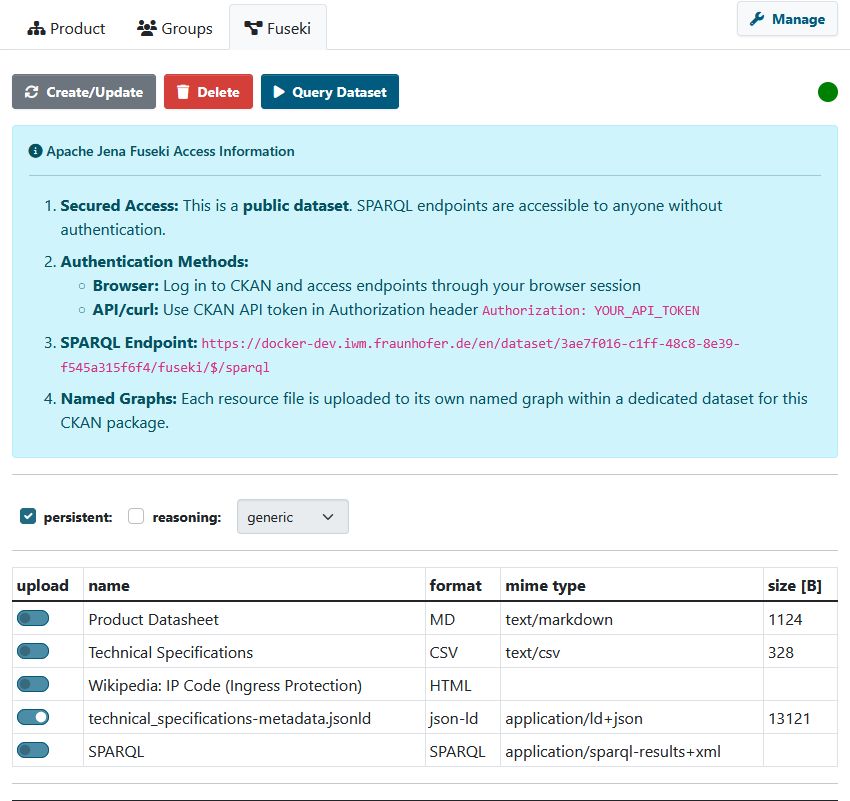

[](https://github.com/Mat-O-Lab/ckanext-fuseki/actions/workflows/test.yml)
[](https://doi.org/10.5281/zenodo.19126035)

# ckanext-fuseki

A CKAN extension for semantic data management in research data portals.
It automatically pushes RDF resources to an Apache Jena Fuseki triple store,
provides a CKAN-authenticated SPARQL proxy that enforces dataset-level access control,
and embeds a YASGUI query interface for interactive SPARQL exploration of linked data.



## Requirements

* **Apache Jena Fuseki** server with custom security configuration (see [Deployment](#deployment) section)
* **CKAN API Token** with admin privileges for background job processing of private datasets

### Fuseki Deployment

This extension requires a **custom Fuseki deployment** with modified security settings to enable CKAN-authenticated access. The necessary files are provided in the `optional/` folder:

- **`optional/fuseki/Dockerfile`** - Custom Fuseki image based on `secoresearch/fuseki:6.2.0`
- **`optional/fuseki/docker-entrypoint.sh`** - Security wrapper that blocks anonymous dataset access
- **`optional/fuseki/index.html`** - Fixed Fuseki UI for subpath deployment
- **`optional/docker-compose.yml`** - Example standalone deployment configuration

See the [optional/README.md](optional/README.md) for standalone deployment instructions, or integrate into your existing Docker Compose setup (see [Deployment](#deployment) section below).

**Optional**: A Sparklis web app for interactive SPARQL querying is also available in the optional folder.

## Features

- **Per-resource upload toggles** — selectively push RDF resources (Turtle, N-Triples, JSON-LD, etc.) to Fuseki
- **Named graphs** — each resource is stored in its own named graph within a dedicated Fuseki dataset
- **CKAN-authenticated SPARQL proxy** — enforces CKAN dataset-level access control on all SPARQL endpoints
  - Public datasets: accessible to anyone via the CKAN proxy
  - Private datasets: require CKAN authentication (browser session or API token)
  - Direct Fuseki access: blocked for anonymous users, admin-only
- **Query Dataset button** — embedded YASGUI interface for interactive SPARQL exploration
- **Persistent & reasoning options** — configurable at dataset level

See [SECURITY.md](SECURITY.md) for the full security architecture.

## Compatibility

| CKAN version    | Compatible? |
| --------------- | ----------- |
| 2.9 and earlier | not tested  |
| 2.10            | ✓ tested    |
| 2.11            | ✓ tested    |


## Installation

### 1. Install the Extension

**From PyPI:**
```bash
pip install ckanext-fuseki
```

**From Source:**
```bash
pip install -e git+https://github.com/Mat-O-Lab/ckanext-fuseki.git#egg=ckanext-fuseki
```

### 2. Deploy Fuseki

Use `secoresearch/fuseki:6.2.0` (Jena 6, Java 21) with the provided configuration files mounted as volumes:

```yaml
services:
  fuseki:
    image: secoresearch/fuseki:6.2.0
    environment:
      - JDK_JAVA_OPTIONS=-Xmx10g -Xms10g -DentityExpansionLimit=0 -Dfuseki:allowAddByConfigFile=true
      - ENABLE_DATA_WRITE=true
      - ENABLE_UPDATE=true
      - ENABLE_UPLOAD=true
      - QUERY_TIMEOUT=60000
    volumes:
      - jena_data:/fuseki-base
      - ./path/to/ckanext-fuseki/optional/fuseki/shiro.ini:/jena-fuseki/shiro.ini
    networks:
      - your_network
    healthcheck:
      test: ["CMD-SHELL", "wget -qO /dev/null http://localhost:3030/$$/ping || exit 1"]
      interval: 10s
      timeout: 5s
      retries: 3
```

- **`shiro.ini`** — configures HTTP Basic Auth; edit to set the admin password. It must contain the `DefaultWebSessionManager` lines from `optional/fuseki/shiro.ini` (Fuseki ≥ 5 requirement).
- The Fuseki UI is served from the image itself and works behind an nginx `/fuseki/` prefix without a custom `index.html` (Fuseki ≥ 5 uses relative asset paths).

**Start Fuseki:**
```bash
docker-compose up -d fuseki
```

#### Fuseki 5.x and 6.x (5.5 and later)

Tested with `secoresearch/fuseki:6.2.0` (Jena 6, Java 21): UI behind an nginx `/fuseki/` prefix, admin login, dataset creation and a full update job. A TDB2 database created with 4.9 was opened unchanged by 5.6.0; an existing database was not re-tested on 6.2.0. Back up the `/fuseki-base` volume before upgrading. Required changes compared to Fuseki 4.9:

1. **`shiro.ini`**: add to `[main]`
   ```ini
   statelessSessionManager = org.apache.shiro.web.session.mgt.DefaultWebSessionManager
   securityManager.sessionManager = $statelessSessionManager
   ```
   Without it every request that passes authentication returns HTTP 500 `No SessionManager`.
2. **Remove the `index.html` mount** (`/jena-fuseki/webapp/index.html`). The UI is served from inside the server jar and works behind an nginx `/fuseki/` prefix.
3. **Dataset creation needs `-Dfuseki:allowAddByConfigFile=true`.** This extension creates one Fuseki dataset per CKAN dataset by posting an assembler description to `POST /$/datasets`. Fuseki 5.5.0 removed that (multipart and raw body) because of CVE-2025-50151 / CVE-2025-49656 (uploaded configuration with unvalidated paths, admin only). The extension now posts the assembly as a raw `text/turtle` body, which Fuseki accepts only with this system property, e.g. `JDK_JAVA_OPTIONS=-Xmx10g -Dfuseki:allowAddByConfigFile=true`. Without it job creation fails with `400 Service configuration from a multipart upload not supported`. Keep Fuseki reachable only for admins (Shiro) and by CKAN; the Jena maintainers have said this switch is a stop-gap.
   Versions up to 5.4.0 accept the old upload without the property but are affected by the two CVEs.
4. The image default command is `org.apache.jena.fuseki.main.cmds.FusekiServerCmd`. If you override `entrypoint:` in compose you must repeat the command, because Compose drops the image `CMD`.

Datasets created with *persistent* off are in-memory and are empty after a Fuseki restart; resubmit them from CKAN.

### 3. Configure CKAN

Add `fuseki` to the `ckan.plugins` setting in your CKAN config file:

```ini
ckan.plugins = ... fuseki
```

### 4. Restart CKAN

```bash
docker-compose restart ckan
# Or for Apache deployment:
sudo service apache2 reload
```

## Config settings

All configuration is read from `ckan.ini` (or the equivalent `CKANINI__` Docker environment variables):

| ckan.ini key | Default | Description |
|---|---|---|
| `ckanext.fuseki.url` | `http://fuseki:3030/` | Direct internal URL of the Fuseki container — **must not** go through nginx |
| `ckanext.fuseki.username` | `admin` | Fuseki admin username — always `admin` (hardcoded by the Fuseki image) |
| `ckanext.fuseki.password` | `admin` | Fuseki admin password — must match the `ADMIN_PASSWORD` env var set on the Fuseki container |
| `ckanext.fuseki.ckan_token` | _(empty)_ | CKAN API token for background job callbacks; required to process private datasets |
| `ckanext.fuseki.formats` | `turtle text/turtle n3 nt hext trig longturtle xml json-ld ld+json jsonld` | Space-separated list of resource formats that trigger upload to the triple store |
| `ckanext.fuseki.ssl_verify` | `true` | Verify SSL certificates when connecting to external resource URLs |
| `ckanext.fuseki.sparklis_url` | _(empty)_ | If set, the query button redirects to this Sparklis instance instead of the built-in SPARQL UI |
| `ckanext.fuseki.db_url` | CKAN's `sqlalchemy.url` | SQLAlchemy URL of the database that stores the job status and job log. Normally leave unset. Replaces the former `FUSEKI_SQLALCHEMY_URL` environment variable (which is now ignored). |

Example Docker environment variables (set in `.env`):

```bash
CKANINI__CKANEXT__FUSEKI__URL=http://fuseki:${FUSEKI_PORT}/
CKANINI__CKANEXT__FUSEKI__USERNAME=admin
CKANINI__CKANEXT__FUSEKI__PASSWORD=<your-fuseki-password>
CKANINI__CKANEXT__FUSEKI__CKAN_TOKEN=<your-ckan-api-token>
CKANINI__CKANEXT__FUSEKI__SSL_VERIFY=${SSL_VERIFY}
```

`ckanext.fuseki.url` must be the **container-internal** address (e.g. `http://fuseki:3030/`), not the public nginx URL. CKAN uses this URL for all direct Fuseki API calls and the SPARQL proxy.

If `ckanext.fuseki.ckan_token` is not set, only public resources can be uploaded to the triple store.

## Citation

If you use this software, please cite it. GitHub shows a **"Cite this repository"** button (top right of the repo page) that exports the [CITATION.cff](CITATION.cff) in APA or BibTeX format.

After the first Zenodo release, a DOI-specific BibTeX entry will be available on the Zenodo record. Until then:

```bibtex
@software{hanke_ckanext_fuseki,
  author       = {Hanke, Thomas},
  title        = {ckanext-fuseki},
  url          = {https://github.com/Mat-O-Lab/ckanext-fuseki},
  license      = {AGPL-3.0-or-later},
}
```

## License

[AGPL](https://www.gnu.org/licenses/agpl-3.0.en.html)

## Acknowledgements

This project's work is based on a fork of the repo [etri-odp/ckanext-jena](https://github.com/etri-odp/ckanext-jena), and we like to thank the authors of that project for sharing their work.
It was supported by Institute for Information & communications Technology Promotion (IITP) grant funded by the Korea government (MSIT) (No.2017-00253, Development of an Advanced Open Data Distribution Platform based on International Standards)
